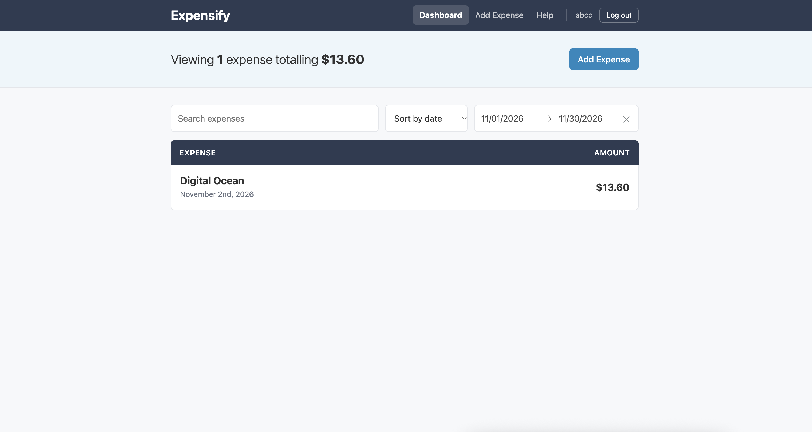
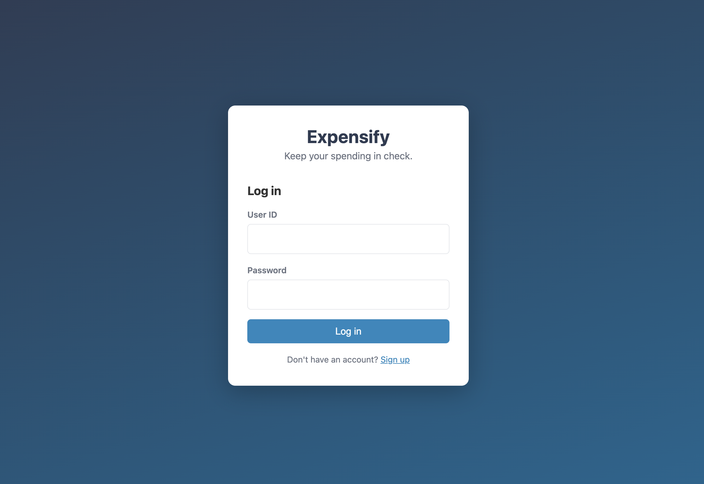
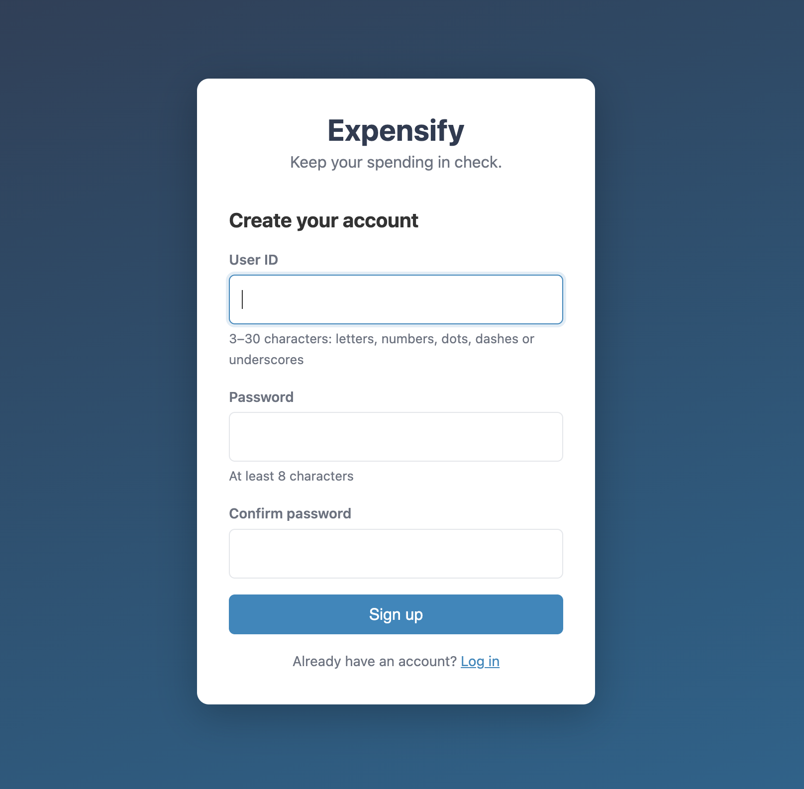
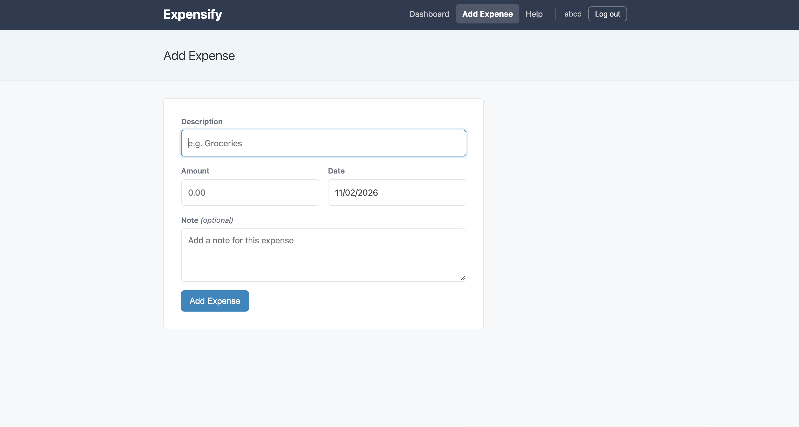

# Expensify — Personal Expense Tracker

A full-stack expense tracker built with **React, Redux, Node.js/Express and MongoDB**. Users create an account, log their expenses, and filter, sort and total them. Each account's data is private to that user.

**🔗 Live demo: [expensify-4l1k.onrender.com](https://expensify-4l1k.onrender.com/)**

> Hosted on Render's free tier, so the first load after a period of inactivity can take 30–60 seconds while the server wakes up. Click **Sign up** to create an account; it takes a few seconds and no email is needed.



## Features

- **Accounts:** sign up and log in with a user ID and password. Sessions last 7 days and survive page refreshes.
- **Private data:** every expense belongs to a user, and the API only ever returns or changes the signed-in user's own expenses.
- **Expense management:** add, edit and remove expenses with a description, amount, date and optional note.
- **Search, sort and filter:** search by text, sort by date or amount, and pick a date range. A summary bar shows how many expenses match and their total.
- **Clear feedback:** form validation, loading states, readable error messages, and an empty state with next steps.
- **Responsive layout** that works on desktop and mobile.

| Log in | Sign up | Add an expense |
|:---:|:---:|:---:|
|  |  |  |

## Tech stack

| Layer | Technologies |
|---|---|
| **Frontend** | React 16 (function components and hooks), Redux with redux-thunk, React Router, SCSS, react-dates, webpack and Babel |
| **Backend** | Node.js, Express, Mongoose |
| **Database** | MongoDB Atlas |
| **Auth** | scrypt password hashing, signed session tokens (JWT) in httpOnly cookies, rate limiting |
| **Testing** | Jest and Enzyme: 97 tests covering components, reducers, selectors and async actions |
| **Deployment** | Render (configured as code in [`render.yaml`](render.yaml)) |

## Engineering highlights

**Security-minded authentication**
- Passwords are hashed with Node's built-in `scrypt` and a random salt per user, and compared in constant time.
- Sessions are signed tokens stored in `httpOnly`, `SameSite=Lax` cookies, which are HTTPS-only in production, so page scripts can't read them.
- Login and sign-up are rate-limited, and a failed login doesn't reveal whether a user ID exists.
- Every database query is scoped to the signed-in user. The owner always comes from the session, never from the request body, so one user can't read or change another user's data.

**Predictable state management**
- Async Redux actions save to the server first and only update the UI once the server confirms, so the screen never shows data that failed to save.
- If a session expires while the app is open, a shared API layer catches the 401 and sends the user back to the login page. After logging in, they return to the page they were on.

**Modernizing a legacy codebase**
- This started as a course project from a few years ago. I brought it up to date by:
  - converting class components to hooks,
  - upgrading React, Enzyme and the Sass toolchain,
  - replacing in-memory state with a real API and database,
  - adding authentication,
  - redesigning the UI,
  - setting up the deployment.
- Along the way I fixed some real bugs, including a crash when refreshing an edit page and two tests that never actually asserted anything.

**Deployment**
- One Render web service builds the React app and runs the Express API, which serves both the frontend and `/api` from the same origin. That means no CORS setup and a single deploy.
- Secrets live in environment variables. The session-signing secret is generated by Render, and none are committed to the repo.

## Architecture

```
Browser (React + Redux)
   │  fetch /api/*  (session cookie)
   ▼
Express server ── /api/auth      signup · login · logout · me
   │            └─ /api/expenses  list · add · update · delete   (signed-in user only)
   │            └─ static files   the built React app
   ▼
MongoDB Atlas  (users, expenses)
```

```
src/                 React app
  actions/           Redux actions and async thunks (auth, expenses, filters)
  api/               fetch wrapper and API calls
  components/        pages and UI components
  reducers/          Redux reducers
  routers/           routing, plus PrivateRoute / PublicRoute guards
  selectors/         filtering, sorting and totals
  tests/             Jest + Enzyme tests
server/              Express API
  auth/              password hashing and session handling
  models/            Mongoose models (User, Expense)
  routes/            /api/auth and /api/expenses
```

## Running locally

**Requirements:** [nvm](https://github.com/nvm-sh/nvm), Node 16 (frontend build) and Node 24 (API), and a MongoDB database such as a free Atlas cluster.

```sh
git clone https://github.com/suhanaayisha/react-course-2-expensify-app.git
cd react-course-2-expensify-app

# Frontend dependencies
nvm install 16 && nvm use 16
npx yarn@1 install

# API dependencies and config
cd server && nvm install && npm install && cd ..
cp server/.env.example server/.env   # then set MONGODB_URI and JWT_SECRET

# Start the API and the React app together
nvm use 16
npx yarn@1 dev
```

Then open **http://localhost:8080**.

| Command | What it does |
|---|---|
| `npx yarn@1 dev` | Runs the API (port 3000) and the webpack dev server (port 8080) together |
| `npx yarn@1 test` | Runs the Jest test suite |
| `npx yarn@1 build:prod` | Builds the production bundle into `public/dist` |

## What I'd add next

- Password reset and account deletion
- Charts for spending by month and category
- Upgrading the build tooling (webpack 4 and Babel 6) so the whole project runs on one modern Node version
